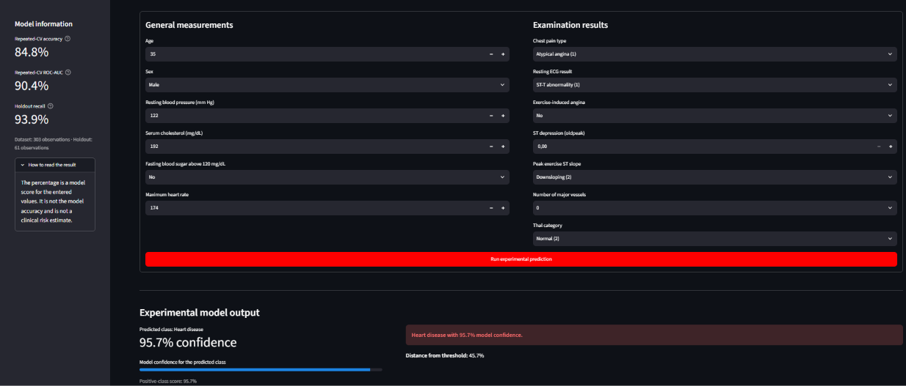

# Heart Disease Classification

An end-to-end machine-learning classification project developed as part of my fourth-year engineering studies. The project explores a small heart disease dataset, compares several classification algorithms, selects a final CatBoost model, and exposes it through an interactive Streamlit application.

> **Educational use only:** this project is not a medical device and must not be used for diagnosis or clinical decision-making.

## Application preview



The application accepts 13 participant attributes and returns:

- the predicted class;
- the model confidence for that class;
- the positive-class score;
- the distance from the classification threshold;
- a warning when the prediction is close to the decision boundary.

## Project objectives

The main objectives were to:

1. explore and clean a real tabular dataset;
2. prevent data leakage with Scikit-learn pipelines;
3. establish a dummy baseline;
4. compare linear, distance-based, tree-based, and boosting models;
5. tune hyperparameters using stratified cross-validation;
6. evaluate accuracy, precision, recall, F1-score, and ROC-AUC;
7. analyse false positives, false negatives, and probability calibration;
8. interpret the final model with permutation importance;
9. deploy the selected model in a Streamlit interface.

## Dataset

The dataset contains **303 observations**, **13 input features**, and one binary target.

Examples of input features include:

- age and sex;
- chest pain type;
- resting blood pressure;
- serum cholesterol;
- fasting blood sugar;
- resting ECG results;
- maximum heart rate;
- exercise-induced angina;
- ST depression and slope;
- number of major vessels;
- thal category.

Missing values occur in `trestbps`, `chol`, and `thalach`. They are handled without leakage during model training.

## Methodology

### Data preparation

- Removed an exported index column.
- Encoded the binary text variables.
- Used stratified train/test splitting.
- Kept preprocessing inside model pipelines.
- Applied mean or median imputation according to the feature distribution.
- Standardised numerical features for Logistic Regression and KNN.
- Applied one-hot encoding where required.

### Models compared

- Dummy Classifier
- Logistic Regression
- K-Nearest Neighbors
- Decision Tree
- Random Forest
- AdaBoost
- CatBoost

The main models were tuned exclusively on the training set. Their stability was then examined with repeated stratified cross-validation.

## Final results

CatBoost provided the best overall combination of classification performance and probability calibration.

| Evaluation | Accuracy | Precision | Recall | F1-score | ROC-AUC |
|---|---:|---:|---:|---:|---:|
| Repeated cross-validation | 0.848 ± 0.057 | 0.852 ± 0.054 | 0.876 ± 0.076 | 0.862 ± 0.054 | 0.904 ± 0.037 |
| Holdout set | 0.836 | 0.795 | 0.939 | 0.861 | — |

Holdout confusion matrix:

| | Predicted negative | Predicted positive |
|---|---:|---:|
| Actual negative | 20 | 8 |
| Actual positive | 2 | 31 |

The holdout contains only 61 observations. These values should therefore be interpreted together with the cross-validation variability, not as precise estimates of clinical performance.

## Model interpretation

Permutation importance identified `ca`, `thal`, and `cp` as the most influential features for the final model on the holdout set.

This analysis explains how the fitted model behaves. It does not demonstrate medical causality or establish the clinical importance of a variable.

## Project structure

```text
heart-disease-classification/
├── app.py
├── data/
│   └── heart_disease_classification_dataset.csv
├── figures/
│   └── streamlit_positive_prediction.png
├── models/
│   ├── heart_disease_catboost.cbm
│   └── model_metadata.json
├── notebooks/
│   └── 01_heart_disease_classification.ipynb
├── .gitignore
├── README.md
└── requirements.txt
```

## Installation

### 1. Clone the repository

```bash
git clone <repository-url>
cd heart-disease-classification
```

### 2. Create a virtual environment

Windows PowerShell:

```powershell
python -m venv .venv
.\.venv\Scripts\Activate.ps1
```

Linux or macOS:

```bash
python -m venv .venv
source .venv/bin/activate
```

### 3. Install the dependencies

```bash
python -m pip install --upgrade pip
pip install -r requirements.txt
```

## Run the notebook

```bash
jupyter notebook notebooks/01_heart_disease_classification.ipynb
```

Run the cells in order. Hyperparameter searches may take several minutes.

## Run the Streamlit application

```bash
streamlit run app.py
```

If the `streamlit` command is unavailable:

```bash
python -m streamlit run app.py
```

The application is then available at `http://localhost:8501`.

## Limitations

- The dataset contains only 303 observations.
- The holdout contains only 61 observations.
- Hyperparameter tuning may still overfit cross-validation.
- The dataset does not represent every patient population.
- The model has not been externally or clinically validated.
- Model confidence is not the same as clinical probability.
- High-confidence predictions can still be incorrect.

## Possible improvements

- Validate the model on an independent dataset.
- Collect more observations and verify the feature definitions with a domain expert.
- Measure performance across demographic subgroups.
- Add automated tests for preprocessing and inference.
- Add experiment tracking and model versioning.
- Deploy the demonstration with Streamlit Community Cloud.

## Technologies

- Python
- pandas and NumPy
- Matplotlib and Seaborn
- Scikit-learn
- CatBoost
- Streamlit
- Jupyter Notebook

## Disclaimer

This repository is a machine-learning learning project. The application output is a model classification based on a small historical dataset. It is not a diagnosis, medical recommendation, or validated estimate of an individual's health risk.
